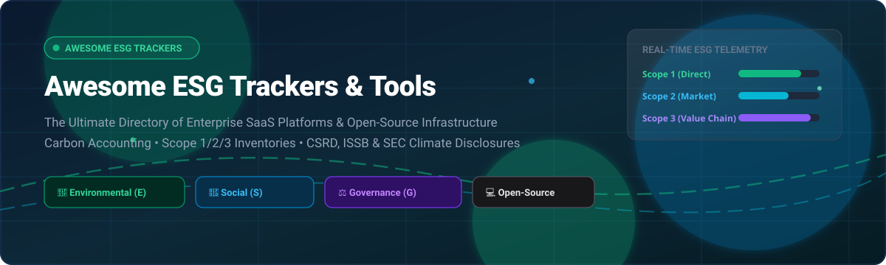

# 🌿 Awesome Environmental, Social, and Governance (ESG) Trackers 📊

  

  
  
  
  
  
  

---

## 🧭 Curated Ecosystem of Enterprise SaaS Platforms & Open-Source ESG Tools

> **A comprehensive, SEO-optimized directory of top Environmental, Social, and Governance (ESG) platforms, carbon accounting tools, and sustainability management systems.**  
> *Focused on GHG Protocol Scope 1/2/3 Measurement, Supply Chain Decarbonization, CSRD, ISSB, and SEC Climate Disclosures.*

**Last updated:** October 2026

This repository curates production-ready **SaaS solutions** and **open-source developer repositories** for tracking ESG metrics, performing audit-grade greenhouse gas (GHG) calculations, monitoring supplier sustainability, and preparing compliant disclosures aligned with European Corporate Sustainability Due Diligence & Reporting (CSRD), the International Sustainability Standards Board (ISSB), and U.S. SEC climate regulations.

---

## 📑 Table of Contents

- [📈 Sector Overview & Market Dynamics](#-sector-overview--market-dynamics)
- [🏢 Enterprise SaaS & Hosted Platforms](#-enterprise-saas--hosted-platforms)
- [💻 Open-Source GitHub Projects](#-open-source-github-projects)
- [🤝 How to Contribute](#-how-to-contribute)
- [💖 Support & Sponsorship](#-support--sponsorship)
- [📊 Star History](#-star-history)
- [⚠️ Disclaimer](#️-disclaimer)

---

## 📈 Sector Overview & Market Dynamics

The global **ESG reporting and carbon management software market** is estimated at **.3B to .5B** in 2024–2026 and is projected to expand past **.6B by 2030**, growing at a rapid Compound Annual Growth Rate (CAGR) of **~20% to 26%**. This growth is catalyzed by the worldwide shift from voluntary corporate sustainability reporting to **legally binding disclosure mandates** (notably the EU Corporate Sustainability Reporting Directive [CSRD], California SB 253/261, ISSB S1/S2 standards, and SEC Climate Disclosure rules).

The market structure remains **moderately fragmented**. Established enterprise Governance, Risk, and Compliance (GRC) and financial reporting leaders (**Workiva**, **Diligent**, **Sphera**) maintain significant enterprise footprint due to existing ERP integrations and XBRL audit capabilities. Simultaneously, the market has welcomed high-growth, venture-backed climate accounting pureplays (**Watershed**, **Persefoni**, **Sweep**, **Measurabl**), alongside specialized rating providers (**EcoVadis**, **Sustainalytics**), creating an active hybrid landscape with no single winner-take-all monopoly.

---

## 🏢 Enterprise SaaS & Hosted Platforms

| Platform | Company Size (Valuation / Revenue) | Starting Tier Pricing | Free Tier / Trial Limits | Description & Key Strengths |
| :--- | :--- | :--- | :--- | :--- |
| **[Diligent ESG](https://www.diligent.com/)** | ~.0B valuation (~+ ARR) | ~,000/year (base tier; ~,800–,000/year typical deployment; ~£700/seat/year) | No free plan; custom proof-of-concept / sales-assisted trial only (feature & seat caps set per evaluation) | Enterprise GRC & ESG platform with board-level oversight and regulatory disclosure management. |
| **[Workiva](https://www.workiva.com/)** | ~.0B market cap (~ TTM revenue) | ~,000/year (modular starting tier; ~,000/year average contract) | No free plan; no self-serve free trial (guided product demos only) | Enterprise reporting platform with **Sustainability Cloud (Workiva Carbon)** for EU CSRD and SEC compliance with XBRL tagging. |
| **[Sphera](https://sphera.com/)** | ~.0B valuation (~+ revenue) | ~€329/user/year (Sphera BOMcheck base; ~,000/year entry enterprise suite) | No permanent free plan; 45-day free trial for *LCA for Experts* (read-only BOMcheck Manufacturer tier) | Enterprise sustainability, EHS, operational risk, and life-cycle assessment platform with auditable calculation logic. |
| **[Watershed](https://watershed.com/)** | .8B valuation (Series C) | ~,000/year (entry annual subscription; typical deployments ~,000–,000+/year) | No free plan; no time-bounded self-serve free trial (custom pilots/demos; free Open CEDA emission database access) | End-to-end carbon accounting and reduction platform covering Scope 1/2/3, supplier data, and clean power procurement. |
| **[EcoVadis](https://ecovadis.com/)** | .0B valuation (~– estimated revenue) | ~€500–€1,500/year (Basic Plan for suppliers < €25M revenue) | Up to 6-week free questionnaire completion window (scorecard evaluation & submission requires paid annual plan) | Global supply chain sustainability ratings, supplier ESG assessments, and improvement tracking across 150k+ entities. |
| **[Measurabl](https://www.measurabl.com/)** |  valuation (~– ARR) | –/building/month (Reporter / Standard paid tiers; ~–/building/year) | Free-forever basic tier (unlimited duration; centralized utility metrics & benchmarks; framework reporting gated) | Real estate ESG platform collecting and benchmarking building-level energy, water, carbon, and waste metrics. |
| **[Persefoni](https://persefoni.com/)** |  valuation (~– ARR) | ,000/year (Advanced enterprise tier starting contract) | Free-forever plan (*Persefoni Pro*): 1 user seat, full Scope 1/2/3 calculations, limited to standard factors & no custom export packs | AI-native carbon accounting platform with Persefoni Copilot, anomaly detection, PCAF financed emissions, and CSRD reporting. |
| **[Novata](https://www.novata.com/)** | ~– valuation (~ ARR) | ,000/year (*Manage* tier) | Promotional Free Carbon Trial (limited feature set and transactional limits; full suite requires demo/contract) | ESG data management platform for private markets, tracking carbon and ESG metrics for portfolio companies (up to 10 facilities/100 suppliers on base tier). |
| **[Sustainalytics](https://www.sustainalytics.com/)** | ~ acquisition value (~+ revenue at acquisition, now Morningstar) | ~,000–,000+/year (entry portfolio licensing / API data feeds) | No free commercial API tier; limited free company ESG risk summary lookups on public web directory | Institutional ESG research, corporate risk ratings, controversy screening, and sustainable finance data. |
| **[Sweep](https://www.sweep.net/)** | ~+ total funding raised (Series B) | ~/month (entry base edition; comprehensive enterprise contracts quote-based) | No self-serve free trial (guided demo & custom evaluation sandboxes only) | Carbon and ESG data management platform for Scope 1/2/3 tracking, supplier engagement, and CSRD compliance. |

---

## 💻 Open-Source GitHub Projects

Open-source ESG tools and carbon calculation engines sorted by GitHub community stars (descending):

| Project | Stars | Focus & Technology | Description |
| :--- | :--- | :--- | :--- |
| **[CodeCarbon](https://github.com/mlco2/codecarbon)** |  | Compute Emission Tracking (Python) | Lightweight Python package to seamlessly track and estimate hardware electricity consumption and equivalent CO2 emissions of algorithms and AI workloads. |
| **[Cloud Carbon Footprint](https://github.com/cloud-carbon-footprint/cloud-carbon-footprint)** |  | Cloud Infrastructure Footprinting (TypeScript/Node) | Measures, analyzes, and visualizes energy consumption and carbon emissions across multi-cloud architectures (AWS, Google Cloud, Microsoft Azure). |
| **[Eco2AI](https://github.com/sb-ai-lab/Eco2AI)** |  | ML / Deep Learning Energy & Carbon (Python) | Python tracker designed for data science teams to measure power consumption, equivalent greenhouse gas emissions, and regional carbon intensity during machine learning training. |
| **[Blockchain Carbon Accounting](https://github.com/hyperledger-labs/blockchain-carbon-accounting)** |  | Auditable Climate Ledgers (Hyperledger / Solidity) | Hyperledger Climate Action & Accounting SIG project implementing auditable, distributed ledger contracts for emission tokenization, carbon credits, and verifiable climate claims. |
| **[Impact Framework](https://github.com/Green-Software-Foundation/if)** |  | Green Software Foundation Engine (TypeScript) | Modular computational framework from the Green Software Foundation to model, calculate, and benchmark environmental impacts of software systems. |
| **[Moja Global FLINT](https://github.com/moja-global/FLINT)** |  | Land Sector Carbon Accounting (C++ / Python) | Full Lands Integration Tool (FLINT) under the Linux Foundation; enterprise-grade engine combining spatial/aspatial models for land-use forestry and carbon removals across 40+ countries. |
| **[Equinox](https://github.com/open-risk/equinox)** |  | Sustainable Finance Risk & PCAF (Python / Django) | Holistic risk management platform for sustainable finance, supporting Scope 2 energy accounting, PCAF mortgage/project finance emissions, and EBA criteria. |
| **[Carmen](https://github.com/Green-Software-Foundation/if-carmen)** |  | Kubernetes & Cloud Impact (Python) | Carbon measurement engine implementing the Impact Framework to track emissions from cloud infrastructure and containerized Kubernetes applications. |
| **[OS-Climate Hazard](https://github.com/os-climate/hazard)** |  | Climate Risk & Hazard Modeling (Python) | Open-source platform under the Linux Foundation OS-Climate umbrella for physical climate risk analysis, hazard datasets, and financial scenario modeling. |
| **[CarbonInk](https://github.com/lxzxl/carbonink)** |  | Desktop Local-First ISO 14064 (Rust / TypeScript) | Local-first desktop carbon accounting platform; uses AI bill extraction to generate ISO 14064-1 reports offline with zero cloud dependency and MCP server support. |
| **[Automated ESG Tracker](https://github.com/kritinkaul/automated-esg-tracker)** |  | Real-Time News & Sentiment (Python / Streamlit) | Live ESG metrics tracker combining financial datasets with News API sentiment analysis and a Streamlit dashboard. |
| **[OpenGHG](https://github.com/mindsongreen/OpenGHG)** |  | Methodology-Transparent Calculation (PHP / PostgreSQL) | Transparent corporate GHG inventory calculator using federated databases, explicit unit algebra, and zero black-box calculations. |

---

### 🌐 Standards, APIs, & Ecosystem Resources

- 📚 **[GHG Protocol Calculation Tools](https://ghgprotocol.org/)** — Foundational global accounting standards and Excel-based calculation toolkits for Scopes 1, 2, and 3.
- 🔌 **[Climatiq API](https://www.climatiq.io/)** — Carbon intelligence calculation API with a verified global emission factor database.
- 🌿 **[Awesome Carbon Accounting & Offsets](https://github.com/brandonhimpfen/awesome-carbon-accounting-offsets)** — Curated list of offsetting protocols, carbon marketplaces, and ESG initiatives.
- 🍃 **[Awesome Green Software](https://github.com/Green-Software-Foundation/awesome-green-software)** — Directory of carbon-aware systems and energy metrics curated by the Green Software Foundation.
- ⚡ **[n8n ESG Workflows](https://n8n.io/)** — Low-code automation templates for parsing utility invoices and orchestrating supplier Scope 3 questionnaires.

---

## 🤝 How to Contribute

Contributions are warmly welcome! You can help expand this curated tracker:

1. **Fork the repository** 🍴
2. **Create a branch** for your update:
   `ash
   git checkout -b feature/add-new-esg-tracker
   `
3. **Add or refine an entry** in README.md adhering to the table format.
4. **Submit a Pull Request** with a brief summary explaining the tool's ESG focus, pricing/license, and regulatory alignment.

🌟 **Star this repository** if you find it helpful for your sustainability initiatives!

---

## 💖 Support & Sponsorship

If this curated repository saves you time, helps your ESG reporting journey, or powers your sustainability research, please consider supporting the project:

- ⭐ **Star this repository** to improve visibility for the ESG and open-source community!
- 🍴 **Fork and share** it with colleagues, developers, and sustainability managers.
- ☕ **Support future development & maintenance:**  
    
  *Support via the [GitHub Sponsors Dashboard](https://github.com/sponsors/ishandutta2007) — every coffee helps keep this ecosystem up-to-date! Thank you!*

---

## 📊 Star History

---

## ⚠️ Disclaimer

- This repository is a **community-curated research directory** and does not constitute formal legal, auditing, or investment advice.
- Corporate sustainability tracking systems handling regulatory filings must comply with applicable jurisdictions (including EU CSRD, ISSB, California SB 253/261, ISO 14064, and the GHG Protocol Corporate Standard).
- **Open-source solutions versus enterprise assurance:** While open-source tools like *CarbonInk*, *CodeCarbon*, and *OpenGHG* provide unrivaled transparency, auditability, and local control, end-to-end assurance sign-off often requires integration with accredited sustainability auditors and assurance teams.
- All brand names, logos, and registered trademarks belong to their respective corporate owners.